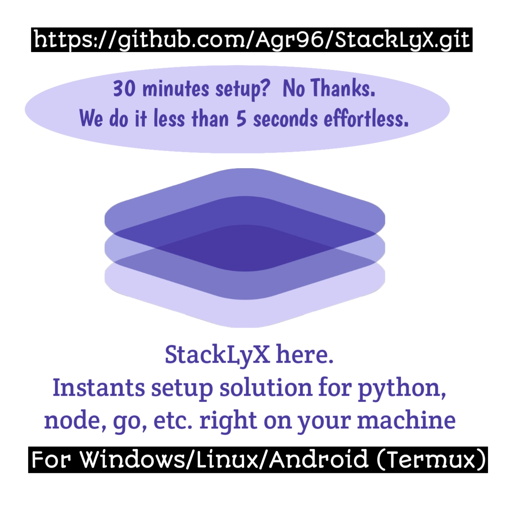

<p align="center">
  
</p>

<h1 align="center">StackLyX</h1>

<p align="center">
  Offline development environment bootstrapper untuk Termux dan Debian melalui PRoot.
</p>

> **Status: prototipe awal / belum siap untuk penggunaan umum.**

## Tentang StackLyX

StackLyX dibuat untuk membantu menjalankan workflow development Linux dari perangkat
Android tanpa root. Ide utamanya adalah memisahkan:

- **Termux** sebagai host environment;
- **Debian melalui `proot-distro`** sebagai Linux userland;
- **toolchain project** yang dapat dijalankan secara offline;
- **sesi `tmux`** yang tetap hidup ketika terminal utama ditutup.

Target awal proyek ini adalah perangkat Android `aarch64`, dengan rencana terpisah
untuk `amd64`. Paket dan environment diharapkan dapat didistribusikan melalui Git,
ZIP, atau penyimpanan lokal ketika koneksi internet terbatas.

## Mengapa proyek ini dibuat?

StackLyX berangkat dari beberapa kebutuhan:

- menyiapkan environment coding di HP Android tanpa akses root;
- mengurangi setup manual berulang untuk setiap project;
- memisahkan dependency Termux dan dependency Debian;
- menyediakan mode instalasi yang dapat bekerja dengan paket offline;
- mempertahankan sesi development melalui `tmux`.

StackLyX **bukan** pengganti Docker atau Kubernetes. Pada Android non-root,
pendekatan berbasis PRoot lebih realistis daripada container Linux penuh karena
Docker/Podman membutuhkan kemampuan kernel yang biasanya tidak tersedia.

## Kondisi implementasi saat ini

Repository ini masih berupa proof-of-concept. Yang tersedia saat ini:

- beberapa script Bash untuk bootstrap dan pembuatan sesi project;
- generator `start-[name].sh` dan `stop-[name].sh`;
- script `safe_update.sh` dengan konsep backup dan rollback;
- beberapa paket `.deb` untuk `aarch64`;
- dokumentasi awal mengenai pemisahan Termux dan Debian.

Fitur berikut **belum selesai atau belum tersedia secara konsisten**:

- dukungan `amd64`;
- instalasi otomatis `proot-distro` dan root filesystem Debian;
- bundle runtime Python, Node.js, Go, atau Rust;
- dependency cache lengkap untuk mode offline;
- sistem role/plugin;
- update terverifikasi dengan checksum dan rollback atomik;
- pengujian otomatis dan distribusi release.

Karena itu, script di repository ini sebaiknya dianggap sebagai bahan eksperimen,
bukan installer yang aman untuk dipakai pada data penting.

## Struktur repository

```text
.
├── core-system/
│   ├── give-me-name.sh
│   ├── start-[name].sh
│   └── stop-[name].sh
├── global_resource/
│   └── aarch64/binary/
│       └── *.deb
├── images/
├── docs/
├── run_me.sh
├── safe_update.sh
└── name.txt
```

## Percobaan lokal

Pastikan Anda memahami isi script sebelum menjalankannya. Beberapa script
mengasumsikan struktur direktori Termux tertentu dan belum melakukan validasi
dependency secara lengkap.

```bash
bash -n run_me.sh safe_update.sh core-system/*.sh
```

Alur prototipe yang direncanakan:

```text
Termux
  └── project directory
      ├── generator nama project
      ├── start-[name].sh
      ├── stop-[name].sh
      └── tmux session
```

## Batasan teknis

- PRoot bukan virtual machine dan bukan container dengan isolasi kernel penuh.
- Performa filesystem dan syscall dapat lebih lambat dibanding Linux native.
- Sebagian software yang membutuhkan privilege kernel tidak akan berjalan.
- Paket `.deb` harus cocok dengan arsitektur dan distro target.
- Paket untuk `aarch64` tidak dapat dipakai pada `amd64`, dan sebaliknya.
- Mode offline memerlukan seluruh dependency transitif, bukan hanya paket utama.
- Menjalankan script yang belum diverifikasi dapat mengubah atau menghapus file lokal.

## Arah pengembangan

Prioritas pengembangan yang realistis:

1. Fokus pada Android `aarch64` dan Termux.
2. Tambahkan pemeriksaan dependency, arsitektur, ruang disk, dan path.
3. Sediakan Debian rootfs yang versioned dan memiliki checksum.
4. Pisahkan data pengguna dari core StackLyX.
5. Buat update atomik dengan backup yang dapat diverifikasi.
6. Tambahkan smoke test untuk setiap script.
7. Setelah MVP stabil, baru pertimbangkan `amd64`, runtime tambahan, dan plugin.

## Kapan StackLyX cocok digunakan?

StackLyX cocok untuk eksperimen, pembelajaran, dan workflow coding ringan di
Android tanpa root, khususnya ketika pengguna membutuhkan environment yang dapat
dipindahkan dan tersedia secara offline.

Untuk Linux desktop atau server, gunakan solusi yang lebih matang seperti
Dev Containers, Docker/Podman, `mise`, `uv`, atau Nix sesuai kebutuhan.

## Lisensi

Repository ini belum memiliki file lisensi resmi. Jangan menganggap kode ini
memiliki izin penggunaan, redistribusi, atau komersialisasi tertentu sebelum
lisensi ditambahkan.
